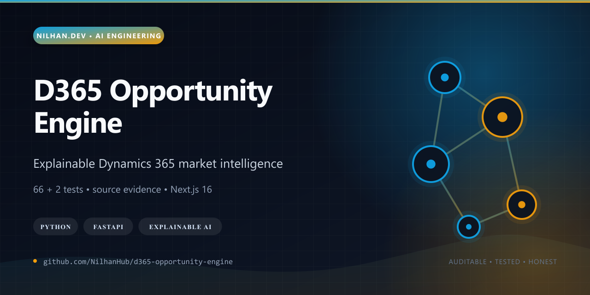
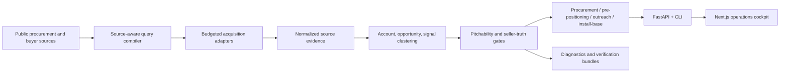

# D365 Demand + Opportunity Radar

[](https://github.com/NilhanHub/d365-opportunity-engine/actions/workflows/ci.yml)
[](LICENSE)
[](pyproject.toml)
[](apps/web/package.json)



This repository is an explainable market-intelligence pipeline for finding public Microsoft Dynamics 365 demand and separating it into seller-meaningful lanes: active procurement, pre-positioning, direct outreach, and install-base triggers.

Rather than flattening every web signal into a “lead,” the system preserves source evidence, compiles source-aware queries, follows detail pages within crawl budgets, clusters related accounts and opportunities, applies pitchability gates, and produces verification bundles that make each recommendation auditable.

## Why it stands out

- Python acquisition, normalization, scoring, clustering, orchestration, API, and CLI layers share typed domain contracts.
- A source-aware query compiler renders different strategies for structured APIs, procurement portals, RSS, sitemaps, and buyer websites.
- Seller truth is separated from ingestion volume through lane-specific scores, recommended actions, route-to-market evidence, and health classification.
- Live-first and demo modes are explicit, independently composed, visibly tagged, and purgeable.
- The Next.js cockpit exposes sources, queries, runs, signals, opportunities, diagnostics, triage, and exports without hiding provenance.
- The release passes **66 Python tests**, **2 UI tests**, a Python dependency audit, pnpm peer checks, zero Node advisories, lint, and a Next.js production build.



## Maturity boundary

The engine is a substantial working system, not a promise that every public signal is commercially actionable. Source terms, robots rules, privacy obligations, and local law remain operator responsibilities; seller decisions require human review; and no hosted deployment is advertised from this repository. Demo data is explicitly labelled and kept separate from live acquisition.

`d365-opps` is a Python 3.12 public-internet discovery system for lawful, English-accessible Microsoft Dynamics 365, Business Central, Dataverse, and Power Platform services demand worldwide without Microsoft partner feeds or paid tender aggregators.

The system keeps raw evidence, preserves explainability, and now separates four distinct lanes instead of flattening everything into “tenders.”

## Lane design

- `formal_procurement`
  - Active tenders, RFPs, RFQs, ITTs, IFBs, EOIs, call-offs, and similar bid-now notices.
- `pre_positioning`
  - Procurement plans, prior information notices, market engagement, award notices, framework vehicles, standing offers, supply arrangements, vendor registration, incumbent/renewal signals.
- `direct_outreach`
  - Public buyer-intent signals such as sourcing pages, structured-data job postings, board papers, budget papers, strategy pages, project updates, and transformation announcements.
- `install_base_trigger`
  - Public evidence of legacy or on-prem Microsoft Dynamics estates that may need migration, optimization, or managed support.

These lanes stay linked through account/opportunity/signal clustering, but they are not merged prematurely.

## What changed

- Replaced the old tender-only retrieval path with lane-aware retrieval scoring and explainable actions.
- Added `retrieval_score`, lane-specific scores, `recommended_action`, and `route_to_market`.
- Added `account_cluster`, `opportunity_cluster`, and `signal_cluster`.
- Switched the runtime to live-first defaults. Demo mode is now explicit, separately composed, visibly tagged in the UI, and purgeable.
- Added bootstrap backfill, incremental sync, historical re-score, and demo-purge operations to the pipeline, API, and CLI.
- Replaced the single-query path with a source-aware query execution planner that fans out compiled query families per source and records per-query metrics and watermarks.
- Added source-specific query rendering so HTML portals get valid plain-keyword searches while structured APIs can still use fielded/boolean forms.
- Upgraded the major listing-based adapters to follow detail pages, honor crawl budgets, and extract more reliable notice-level metadata.
- Replaced the placeholder OCDS seed with the real OCP Data Registry discovery seed.
- Replaced placeholder `generic_rss`, `sitemap_portal`, and `search_api` endpoints with real config-driven working examples.
- Expanded the source pack to cover official public procurement surfaces, hosted sourcing discovery, and buyer-web discovery seeds.
- Added coverage and lane reporting commands.

## Default actions

- `bid_now`
- `pre_position`
- `outreach_now`
- `monitor`
- `reject`

## Current source pack

The seeded pack in [`src/d365opps/data/source_pack.json`](src/d365opps/data/source_pack.json) now includes:

- Official procurement APIs and portals:
  - `contracts_finder`
  - `find_a_tender`
  - `ted`
  - `sam_gov`
  - `canada_buys_tenders`
  - `canada_buys_awards`
  - `canada_buys_standing_offers`
  - `austender_atm`
  - `gets_tenders`
  - `gebiz_opportunities`
  - `world_bank_current`
  - `ungm_public_notices`
  - `eu_funding_tenders`
  - `ireland_etenders`
  - `philgeps`
  - `kenya_ppip`
  - `jamaica_gojep`
  - `india_cppp`
- Discovery/control-plane seeds:
  - `ocds_registry`
  - `opentender_search`
  - `generic_rss`
  - `sitemap_portal`
  - `search_api`
  - `generic_web`
- Optional hosted sourcing discovery:
  - `coupa_public_sourcing`
  - `sap_business_network_discovery`

The default seeded pack is no longer “26 sources, 3 live.” Public, English-accessible baseline sources such as `ted`, `contracts_finder`, `find_a_tender`, `ocds_registry`, `opentender_search`, `canada_buys_*`, `austender_atm`, `gets_tenders`, `gebiz_opportunities`, `world_bank_current`, `ungm_public_notices`, `eu_funding_tenders`, `ireland_etenders`, `philgeps`, `kenya_ppip`, `jamaica_gojep`, and `india_cppp` are now enabled by default where they are public and usable without private feeds. Sources that still need credentials, special access, or more parser work stay clearly disabled or non-live.

All sources remain independently enable/disable-able and safe by default.

## Retrieval/query compiler v2

The retrieval rules live in [`src/d365opps/data/retrieval_rules.json`](src/d365opps/data/retrieval_rules.json).

Key defaults:

- No standalone `ERP`, `CRM`, or bare `Copilot` queries.
- Generic ERP/CRM/AI/copilot language contributes only when anchored to Microsoft/Dynamics/Business Central/Dataverse/Power Platform context.
- Legacy Dynamics anchors are included for trigger hunting:
  - `Dynamics NAV`
  - `Navision`
  - `Dynamics AX`
  - `Dynamics CRM`
  - `Dynamics GP`
  - `Great Plains`
  - `Dynamics SL`
  - `Finance and Operations`
- Hard negatives stay config-driven, not hard-coded only.
- Portal fingerprints are config-backed and explainable.

## New CLI commands

```powershell
d365-opps discover-sources
d365-opps query-preview --source ted
d365-opps bootstrap-backfill --source ted --days 90
d365-opps refresh --mode incremental_sync --source ted
d365-opps rescore --since 2026-01-01
d365-opps purge-demo
d365-opps source-health
d365-opps recall-report --fixtures tests/fixtures/retrieval_cases.json
d365-opps discover-accounts
d365-opps coverage-report
d365-opps lane-report
d365-opps source-gap-report
```

### Query preview

`query-preview` now shows:

- `query_family`
- `mode`
- `phase`
- `renderer`
- source-specific query text
- negative filters

This is the fastest way to confirm that a source is no longer receiving invalid pseudo-syntax such as `title:(...)` when the portal only accepts plain keyword strings.

### Export filters

```powershell
d365-opps export --fmt both --signal-lane formal_procurement
d365-opps export --fmt both --recommended-action outreach_now
d365-opps export --fmt both --route-to-market framework_vehicle
```

## Export outputs

The exporter still writes the canonical research dataset, plus lane-specific slices:

- `opportunity_export.csv/jsonl`
- `formal_procurement_export.csv/jsonl`
- `pre_positioning_export.csv/jsonl`
- `direct_outreach_export.csv/jsonl`
- `install_base_trigger_export.csv/jsonl`
- `organization_export.csv/jsonl`
- `account_cluster_export.csv/jsonl`
- `contact_export.csv/jsonl`
- `market_signal_export.csv/jsonl`
- `signal_cluster_export.csv/jsonl`
- `dashboard_snapshot.json`

New fields include:

- `signal_lane`
- `recommended_action`
- `route_to_market`
- `retrieval_score`
- `formal_opportunity_score`
- `pre_position_score`
- `account_intent_score`
- `install_base_trigger_score`
- `service_fit_score`
- `buyer_quality_score`
- `corroboration_score`
- `account_heat_score`
- `installed_product_guess`
- `installed_product_evidence`
- `trigger_type`
- `trigger_strength`
- `procurement_cycle_stage`
- `vehicle_type`
- `incumbent_vendor`
- `incumbent_expiry_guess`
- `buyer_intent_evidence_json`
- `legacy_evidence_json`
- `query_family`
- `portal_fingerprint`
- `public_access_mode`
- `english_evidence_source`
- `known_blind_spot_reason`

## Sample config

See [`examples/source-overrides.example.json`](examples/source-overrides.example.json) for working examples of:

- a real public RSS feed
- a real public sitemap seed
- an optional search API configuration
- a buyer-web target list

## Quick start

1. Install:

```powershell
python -m pip install -e .[dev]
```

2. Initialize the schema and seed sources:

```powershell
d365-opps init-db
d365-opps seed-sources
```

3. Preview live query fan-out:

```powershell
d365-opps query-preview --source ted
```

4. Run a live bootstrap backfill:

```powershell
d365-opps bootstrap-backfill --source ted --source contracts_finder --days 90
```

5. Run daily-style incremental sync:

```powershell
d365-opps refresh --mode incremental_sync --source ted --source contracts_finder
```

6. Inspect coverage:

```powershell
d365-opps coverage-report
d365-opps lane-report
```

7. Export:

```powershell
d365-opps export --fmt both
```

8. Re-score historical records after retrieval/rules changes:

```powershell
d365-opps rescore --since 2026-01-01
```

9. Purge demo rows from the current database if they were explicitly seeded earlier:

```powershell
d365-opps purge-demo
```

## Web cockpit

The repo now includes a real internal web application and API layer:

- Python API: [`src/d365opps/api.py`](src/d365opps/api.py)
- Ops read model: [`src/d365opps/ops.py`](src/d365opps/ops.py)
- Demo data seeding: [`src/d365opps/demo.py`](src/d365opps/demo.py)
- Next.js web app: [`apps/web`](apps/web)

## Self-verifying diagnostics

The app is no longer UI-only for diagnosis. Every meaningful job now emits:

- append-only `pipeline_event` records
- correlated `trace_id`, `span_id`, and `request_id`
- richer `source_fetch_event`, `query_execution`, and `job_run` telemetry
- source state transition history
- canary results
- structured NDJSON run logs
- a portable verification bundle under `artifacts/verification/`

### New CLI commands

```powershell
d365-opps verify-pack
d365-opps explain-zero
d365-opps doctor
```

### New API routes

- `/api/diagnostics`
- `/api/diagnostics/empty`
- `/api/diagnostics/source/{source_id}`
- `/api/diagnostics/run/{run_id}`
- `/api/verification/latest`
- `/api/verification/latest/download`
- `/api/verification/{run_id}`
- `/api/verification/{run_id}/download`
- `/api/actions/canary-sweep`
- `/api/actions/verify-pack`
- `/api/actions/doctor`

## Verification bundle

Default bundle path:

- `artifacts/verification/latest/`
- `artifacts/runs/latest/`

Important files inside the bundle:

- `manifest.json`
- `status.json`
- `overview.json`
- `diagnostic_summary.json`
- `dataset_diagnosis.json`
- `source_inventory.json`
- `source_health.json`
- `source_readiness.json`
- `source_state_transitions.ndjson`
- `source_issues.ndjson`
- `source_canaries.ndjson`
- `job_runs.ndjson`
- `crawl_runs.ndjson`
- `query_executions.ndjson`
- `fetch_events.ndjson`
- `pipeline_events.ndjson`
- `metrics.prom`
- `config.redacted.json`
- `environment.redacted.json`
- `source_pack_snapshot.json`
- `samples/*.csv`
- `dashboard_screenshots/*.png`
- `ROOT_CAUSE_REPORT.md`
- `artifacts/runs/latest/pitchability_report.md`
- `artifacts/runs/latest/truth_consistency_report.json`
- `artifacts/runs/latest/run_scope_report.json`

The bundle excludes `node_modules`, `.next`, caches, and blob/database dumps by default. Use explicit opts only when deeper review is required.
If `D365_OPPS_SCREENSHOT_CAPTURE_ENABLED=true` and `D365_OPPS_WEB_BASE_URL` points to a live cockpit instance, the bundle will try to capture real Playwright screenshots for the main routes; otherwise it falls back to deterministic placeholders so the bundle shape stays stable.

## Operator guide

1. Start with `/diagnostics` or `d365-opps explain-zero`.
2. If the live dataset is low or empty, open `dataset_diagnosis.json` and `ROOT_CAUSE_REPORT.md`.
3. Validate source labels using:
   - `source_health.json`
   - `source_state_transitions.ndjson`
   - `source_canaries.ndjson`
   - `source_issues.ndjson`
4. Validate retrieval behavior using:
   - `query_executions.ndjson`
   - `fetch_events.ndjson`
   - `pipeline_events.ndjson`
5. Validate evidence behind a lead using:
   - `samples/evidence.csv`
   - `samples/opportunities.csv`
   - source/raw blob paths referenced in bundle records
6. Download the latest pack directly from the UI or:

```powershell
d365-opps verify-pack
d365-opps refresh-oracle-instructions
```

## Health classification

`healthy` now requires recent evidence:

- a recent successful fetch or a recent passing canary
- and no dominant open blocker such as `blocked_403`, `blocked_401`, `robots_blocked`, `parser_error`, or `parser_drift`

This prevents “enabled but unproven” sources from being mislabeled as healthy.

### Runtime modes

- `compose.yaml`
  - live-first default stack. `D365_OPPS_DEMO_MODE` is `false`.
- `compose.live.yaml`
  - explicit live override for operators who want a named live compose file.
- `compose.demo.yaml`
  - explicit demo stack override. Uses a separate demo SQLite path by default so demo rows do not quietly pollute a live working database.

The UI and API now expose `data_mode` as `LIVE`, `DEMO`, or `MIXED`. The top bar shows a persistent environment badge, and overview metrics split live vs demo rows so operators cannot mistake seeded examples for real leads.

### Local web setup

1. Install Python dependencies:

```powershell
python -m pip install -e .[dev]
```

2. Install web dependencies:

```powershell
cd apps/web
npm install
cd ../..
```

3. Start the live API:

```powershell
python -m uvicorn d365opps.api:app --host 127.0.0.1 --port 8000
```

4. Start the web app:

```powershell
cd apps/web
$env:D365_OPPS_API_BASE_URL = "http://127.0.0.1:8000"
$env:NEXT_PUBLIC_API_BASE_URL = "http://127.0.0.1:8000"
npm run dev
```

Open:

- Web cockpit: [http://127.0.0.1:3000](http://127.0.0.1:3000)
- API docs: [http://127.0.0.1:8000/docs](http://127.0.0.1:8000/docs)
- Metrics: [http://127.0.0.1:8000/metrics](http://127.0.0.1:8000/metrics)

### Compose

The root [`compose.yaml`](compose.yaml) runs the live-first stack:

- `postgres`
- `api`
- `web`
- optional `prometheus` profile

Start the full stack:

```powershell
docker compose up --build
```

Start the explicitly named live stack:

```powershell
docker compose -f compose.yaml -f compose.live.yaml up --build
```

Start the explicit demo stack:

```powershell
docker compose -f compose.yaml -f compose.demo.yaml up --build
```

Start with observability:

```powershell
docker compose --profile observability up --build
```

### Demo mode

- Demo mode is opt-in via `D365_OPPS_DEMO_MODE=true` or `compose.demo.yaml`.
- When enabled, startup seeds a realistic source/runs/issues/opportunities/signals dataset if the target database is still empty.
- Demo rows are tagged, counted separately, filterable in the UI/API, and surfaced through `/api/status`.
- The API exposes `POST /api/actions/purge-demo` and the CLI exposes `d365-opps purge-demo` for cleanup.
- The seeded dataset includes healthy, throttled, blocked, auth-required, parser-drift, candidate, high-yield, and low-yield cases so the UI is immediately useful without pretending those are live opportunities.

## Website route inventory

- `/`
  - Executive Overview
- `/sources`
  - Source Command Center
- `/sources/[id]`
  - Source detail
- `/discovery`
  - Discovery and candidate sources
- `/methods`
  - Method lab
- `/queries`
  - Query execution view
- `/runs`
  - Run monitor with live SSE updates for refresh/discovery/export activity
- `/runs/[id]`
  - Run detail
- `/issues`
  - Source issues and blockers
- `/opportunities`
  - Opportunity explorer
- `/opportunities/[id]`
  - Opportunity detail
- `/signals`
  - Signal explorer
- `/accounts`
  - Account and buyer view
- `/coverage`
  - Coverage and blind spots
- `/exports`
  - Export history and schema browser
- `/settings`
  - Operator actions and saved views

## API surface

The FastAPI app exposes:

- `/api/status`
- `/api/overview`
- `/api/sources`
- `/api/sources/{id}`
- `/api/sources/{id}/runs`
- `/api/sources/{id}/issues`
- `/api/sources/{id}/documents`
- `/api/discovery/candidates`
- `/api/issues`
- `/api/runs`
- `/api/runs/stream`
- `/api/runs/{id}`
- `/api/queries`
- `/api/opportunities`
- `/api/opportunities/{id}`
- `/api/signals`
- `/api/accounts`
- `/api/coverage`
- `/api/exports`
- `/api/saved-views`
- `/api/actions/refresh`
- `/api/actions/bootstrap-backfill`
- `/api/actions/discover-sources`
- `/api/actions/approve-source`
- `/api/actions/reject-source`
- `/api/actions/reprocess`
- `/api/actions/rescore`
- `/api/actions/purge-demo`
- `/api/actions/export`
- `/metrics`

## Status classification

### Operational state

- `healthy`
  - Fetching works and the source is currently reachable.
- `degraded`
  - Reachable but showing recent failures, weak success rate, or incomplete behavior.
- `throttled`
  - Significant `429` pressure.
- `blocked`
  - Public requests are refused.
- `robots_disallowed`
  - The source should not be crawled under current rules.
- `auth_required`
  - Credential or API-key path is missing.
- `parser_broken`
  - The source is reachable but the parser is drifting or broken.
- `unstable`
  - Success is intermittent.
- `disabled`
  - Intentionally off.
- `unsupported`
  - Known public surface exists but is not realistically usable.
- `unknown`
  - No operating history yet.

### Yield state

- `high_yield`
- `normal_yield`
- `low_yield`
- `zero_yield`
- `noisy`
- `stale`
- `unknown`

These are intentionally separate from availability so the UI can distinguish:

- healthy but low value
- reachable but throttled
- broken parsing on a live source
- blocked portals

## Issue taxonomy

The UI and API normalize source incidents into codes such as:

- `throttled_429`
- `blocked_403`
- `blocked_401`
- `robots_blocked`
- `auth_missing`
- `api_key_missing`
- `parser_error`
- `parser_drift`
- `timeout`
- `ssl_error`
- `dns_error`
- `captcha_or_challenge`
- `empty_result`
- `no_english_path`
- `unsupported_content_type`
- `source_stale`
- `low_yield_suspected`
- `high_noise_suspected`

Each issue stores severity, first/last seen, example URL/status, impact, and recommended remediation.

## Operator guide

See [`docs/operator-guide.md`](docs/operator-guide.md) for:

- how to read each screen
- how to trigger jobs from the UI
- how live/demo mode is exposed and cleaned up
- how bootstrap backfill differs from incremental sync
- how to interpret source health vs yield
- how recall sanity alerts are triggered
- how to use demo mode during local development
- what blind spots still remain

## Testing

```powershell
pytest -q
```

The test suite now covers:

- query compilation and hard negatives
- query rendering for plain-keyword portals vs field-capable APIs
- lane assignment
- direct outreach and install-base trigger promotion
- source discovery from feeds, sitemaps, structured data, and hosted sourcing fingerprints
- pipeline persistence of lane metadata
- pipeline query fan-out, watermarks, rescoring, and demo purge
- coverage and lane reports
- ops read-model aggregation
- FastAPI endpoints
- source status classification
- web component smoke tests

Run frontend component tests:

```powershell
cd apps/web
npm test
```

## Migration notes

- The schema gained new columns and new tables:
  - `account_cluster`
  - `signal_cluster`
  - lane/action/trigger/account fields on evidence, candidates, signals, sources, and discovery candidates
- Runtime defaults changed materially:
  - demo mode is no longer the default
  - live compose is the default path
  - the source pack enables a real public baseline instead of only three live sources
  - fetch windows and crawl budgets are larger and now split between bootstrap backfill and incremental sync
- The pipeline now stores per-query execution metrics and per-query/per-mode watermarks inside source config metadata.
- Historical evidence/opportunities can be re-scored after retrieval rule changes, and demo rows can be purged explicitly.
- This MVP still uses `create_all`, not a formal migration framework.
- For existing local SQLite databases created before this upgrade, start from a fresh database file before rerunning `d365-opps init-db`.

## Known blind spots

- Some public procurement portals remain highly dynamic or expose only partial public metadata until a deeper source-native adapter replaces the HTML fallback.
- Hosted sourcing vendors often show a public shell but keep the real event detail behind buyer-specific or free-account flows.
- English-only export means some valid opportunities stay in audit-only buckets when no English page, alternate page, or English attachment is public.
- Source-native query rendering now avoids obvious syntax loss, but several sources still need richer per-portal rendering and better category/filter exploitation.
- Country coverage is materially broader than before, but extraction depth still varies by portal family, detail-page structure, and attachment quality.
